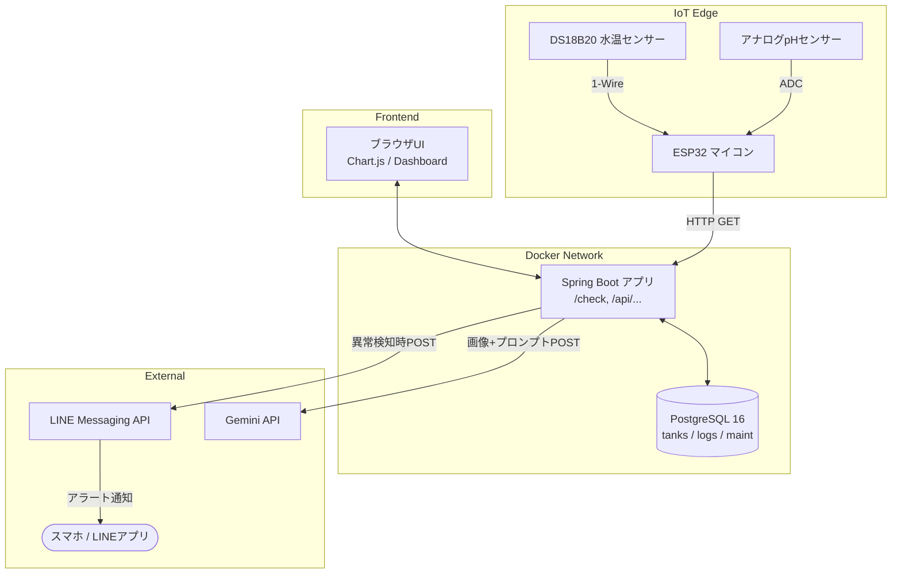

# 🐠 金魚水質管理システム (Goldfish Water Quality Tracker)

金魚飼育における水質環境（水温・pH）のセンサー自動計測・記録・自動診断、および時系列推移の可視化を行うIoT連携フルスタックWebアプリケーションです。  
ESP32マイコン、Spring Boot、PostgreSQL、モダンJavaScript、Docker Compose を組み合わせて構築しています。

---

## 📌 概要・開発背景

- **開発動機:**  
  繊細な水質管理が求められる観賞魚飼育において、日々の水温変化やpH降下（酸性化）を早期に察知し、適切な換水タイミングを判断するために開発しました。
- **主な機能:**
  - **IoTセンサー自動計測・送信:**  
    ESP32に接続した防水水温センサー（DS18B20）とアナログpHセンサーから、定期的にHTTP経由で水質データを自動収集。
  - **水槽マスタ管理＆個別トラッキング:**  
    室内ガラス水槽や屋外トロ舟など、飼育環境ごとの水質データを分離して保持・管理。
  - **リアルタイム水質自動診断・LINEアラート:**  
    入力値から適正範囲（低水温・高水温、酸性化・アルカリ化）を即時判定。異常検知時はLINE Messaging APIを経由して管理者のスマホへ警告を自動送信。
  - **推移ダッシュボード (Chart.js) ＆ メンテナンス可視化:**  
    水温（赤軸）とpH（青軸）を2軸折れ線グラフで可視化。「1/3換水」などのメンテナンス記録を入力するとグラフ上に縦線マーカーが引かれ、水質回復の効果が一目でわかるUIを実装。
  - **🧮 推奨換水量シミュレーター:**  
    現在のpH値と目標値（中性）の対数計算から、必要な換水量を即座に算出。生体へのショックを防ぐため、一度の換水量を最大50%に制限するセーフティガード機構も実装。
  - **📷 週末のAI水量・水質総合チェック:**  
    スマホ等で撮影した水槽画像、現在の水質（水温・pH）、水槽寸法をGemini APIに送信。視覚的な水位低下と化学的な水質状況の両面から、プロのアクアリスト目線での具体的な換水・足し水アドバイスを自動生成。
  - **データ永続化設計:**  
    Docker Volume を利用し、コンテナの破棄・再起動時にも蓄積ログが消失しない環境を構築。

---

## 🛠 技術スタック

| カテゴリ           | 採用技術 / ハードウェア                          | 採用理由 / 用途                                                  |
| :----------------- | :----------------------------------------------- | :--------------------------------------------------------------- |
| **IoT / Hardware** | ESP32-WROOM-32, DS18B20, アナログpHセンサー      | Wi-Fi経由のデータ送信、1-Wireプロトコル通信、ADCによる電圧検知   |
| **Backend**        | Java 25, Spring Boot 4.1.1, Spring Data JPA      | 堅牢な型安全性とRESTful API、ORM（JPA）によるDB操作の抽象化      |
| **Database**       | PostgreSQL 16 (Alpine)                           | 信頼性の高いRDBMS、外部キーによる整合性担保                      |
| **Frontend**       | HTML5, CSS3, JavaScript (ES6+ Modules), Chart.js | フレームワーク非依存の軽量構成。モジュール分割と2軸グラフ描画    |
| **Infrastructure** | Docker, Docker Compose                           | 開発環境のコンテナ統一、DB永続化（Docker Volume）のコード管理    |
| **External API**   | LINE Messaging API, Gemini API (3.8-flash)       | リアルタイムなプッシュ通知、および画像・テキスト解析によるAI提案 |

---

## 🏗 システムアーキテクチャ

## 開発中に止まったこと

🧗 開発中に直面した課題と工夫
「水量」ではなく「設置場所（location）」を採用した理由
初期のモデリング検討では、水槽テーブルの属性として「総水量」を持たせる案がありました。しかし、実際の金魚飼育現場では以下の事象が日常的に発生します。

水量は常に変動する: 気温による蒸発や、日常の足し水・換水によって実水量は静的に定まらない。

環境特性の差異が水質に与える影響の方が大きい:

屋内水槽: エアコン等による温度コントロールが効きやすく比較的安定。

屋外飼育: 直射日光による青水の発生、降雨によるpHショックなど外的要因に大きく左右される。

単に水槽の名前を管理するだけでなく、飼育環境の特性差をデータ構造に反映させるため、あえて変動値である水量を排し、location（屋内/屋外）カラムを持たせる設計へと判断を改めました。

はじめてのIoT（ESP32）開発と外部API（LINE / 生成AI）の活用
今回、自身初となるマイコン（ESP32）を用いたハードウェア開発に挑戦しました。ハードウェア特有の配線や、マイコンとローカルサーバー間のネットワーク通信不通、アナログ入力（ADC）の電圧変換と個体差の校正など、Web開発単体では経験しない課題に直面しました。

開発過程では、生成AIを技術的な相談相手（ペアプログラマ）として活用し、エラーログやシリアル通信ログの解析を依頼しながら「なぜこのエラーが起きているのか」という根本原因を論理的に理解・切り分けして実装を進めました。
また、LINE Messaging APIの実装では近年の仕様変更に伴うトークン管理などに直面しましたが、公式ドキュメントとログを照らし合わせて解決し、センサー計測からバックエンドへのデータ収集、LINE通知連携、さらにはGemini APIによる画像解析までを統合したシステムを完成させることができました。

🚀 これからの展望
本システムをより実用的で高度なサービスへと昇華させるため、以下のアップデートを構想しています。

1. クラウドネイティブなアーキテクチャへの移行
現在のローカル（Docker）環境から、AWSなどのクラウド環境へのデプロイを計画しています。将来的には、ESP32からの通信をHTTPからMQTT（AWS IoT Core）へ移行し、Lambdaを経由してデータベースへ保存する、よりIoTに特化したスケーラブルなサーバーレス構成を目指します。

2. フロントエンドのモダン化（SPA化）
現在のHTML + Vanilla JSによる構成から、ReactなどのモダンUIフレームワークを活用したシングルページアプリケーション（SPA）への刷新を検討しています。画面遷移（リロード）をなくし、水槽ごとのグラフ表示や設定画面をシームレスに切り替えられるUXの向上を図ります。

3. 金魚飼育の実態に即した「冬眠モード」の実装
日本の屋外飼育（トロ舟など）では冬場に金魚を冬眠させる愛好家も多いため、単純な「低水温アラート」は冬場には実用的ではありません。そこで、水槽ごとに「冬眠モード」を設定できるようにし、ONの場合は通常のアラートを停止して「表面凍結の危険（1℃未満）」のみを通知するなど、季節に合わせた柔軟な通知制御を実装予定です。

