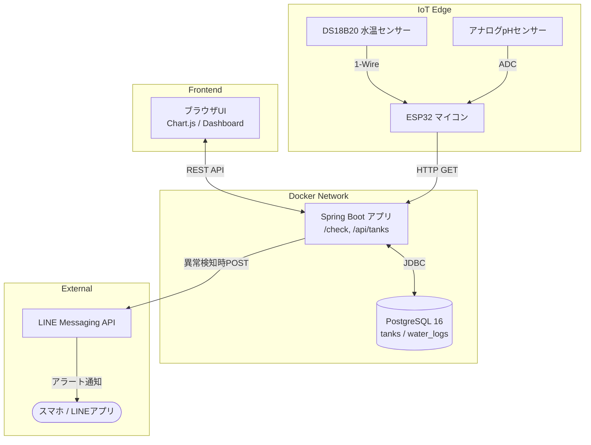

# 🐠 金魚水質管理システム (Goldfish Water Quality Tracker)

金魚飼育における水質環境（水温・pH）のセンサー自動計測・記録・自動診断、および時系列推移の可視化を行うIoT連携フルスタックWebアプリケーションです。  
ESP32マイコン、Spring Boot、PostgreSQL、モダンJavaScript、Docker Compose を組み合わせて構築しています。

---

## 📌 概要・開発背景

- **開発動機:**  
  繊細な水質管理が求められる観賞魚飼育において、日々の水温変化やpH降下（酸性化）を早期に察知し、適切な換水タイミングを判断するために開発しました。
- **主な機能:**
  - **IoTセンサー自動計測・送信:**  
    ESP32に接続した防水水温センサー（DS18B20）とアナログpHセンサーから、定期的にHTTP経由で水質データを自動収集。
  - **水槽マスタ管理＆個別トラッキング:**  
    室内ガラス水槽や屋外トロ舟など、飼育環境ごとの水質データを分離して保持・管理。
  - **リアルタイム水質自動診断:**  
    水温とpHの入力値から、金魚の生体特性に合わせた適正範囲（低水温・高水温、酸性化・アルカリ傾向）を即時判定。
  - **LINE自動アラート通知:**  
    異常値（水温28℃超/15℃未満、pH6.5未満/8.0超など）を検知した際、LINE Messaging APIを経由して管理者のスマホへ即座に警告メッセージを送信。
  - **推移ダッシュボード (Chart.js):**  
    水温（赤軸）とpH（青軸）の2軸折れ線グラフで時系列変化を可視化。
  - **データ永続化設計:**  
    Docker Volume を利用し、コンテナの破棄・再起動時にも蓄積ログが消失しない環境を構築。

---

## 🛠 技術スタック

| カテゴリ           | 採用技術 / ハードウェア                          | 採用理由 / 用途                                                |
| :----------------- | :----------------------------------------------- | :------------------------------------------------------------- |
| **IoT / Hardware** | ESP32-WROOM-32, DS18B20, アナログpHセンサー      | Wi-Fi経由のデータ送信、1-Wireプロトコル通信、ADCによる電圧検知 |
| **Backend**        | Java 17, Spring Boot 3.x, Spring Data JPA        | 堅牢な型安全性とRESTful API、ORM（JPA）によるDB操作の抽象化    |
| **Database**       | PostgreSQL 16 (Alpine)                           | 信頼性の高いRDBMS、外部キーによる整合性担保                    |
| **Frontend**       | HTML5, CSS3, JavaScript (ES6+ Modules), Chart.js | フレームワーク非依存の軽量構成。モジュール分割と2軸グラフ描画  |
| **Infrastructure** | Docker, Docker Compose                           | 開発環境のコンテナ統一、DB永続化（Docker Volume）のコード管理  |
| **External API**   | LINE Messaging API                               | スマホへのリアルタイムなプッシュ通知実現                       |

---

## 🏗 システムアーキテクチャ

## 開発中に止まったこと

#「水量」ではなく「設置場所（location）」を採用した理由
初期のモデリング検討では、水槽テーブルの属性として「総水量」を持たせる案がありました。

しかし、実際の金魚飼育現場では以下の事象が日常的に発生します。

水量は常に変動する: 気温やエアコンによる水分の蒸発、日常の足し水や換水（水換え）によって実水量は静的に定まらない。

環境特性の差異が水質に与える影響の方が大きい:

屋内水槽: エアコンやヒーターによる水温コントロールが効きやすく、人工照明下で比較的安定。

屋外飼育（トロ舟・プラ舟など）: 直射日光による青水（植物プランクトン）の発生、降雨によるpHショックや急激な水温低下など、外的環境要因に大きく左右されます。

単に水槽の名前を管理するだけでなく、飼育環境の特性差をデータ構造に反映させるため、あえて変動値である水量を排し、location（屋内/屋外）カラムを持たせる設計へと判断を改めました。

#はじめてのIoT（ESP32）開発と生成AIの活用
今回、自身初となるマイコン（ESP32）を用いたハードウェア開発に挑戦しました。
ハードウェア特有の配線や、マイコンとローカルサーバー間のネットワーク通信不通、アナログ入力（ADC）の電圧変換と個体差の校正など、Web開発単体では経験しない課題に直面しました。

開発過程では、生成AIを技術的な相談相手（ペアプログラマ）として活用し、エラーログやシリアル通信ログの解析を依頼しながら「なぜこのエラーが起きているのか」という根本原因を論理的に理解・切り分けして実装を進めました。結果として、センサー計測からDockerコンテナ上のバックエンドへのデータ収集、LINE通知連携までを完成させることができました。

LINEのMessaging APIを使ったのも初めてだったので、apiの取得に困惑しました。
開発時にはMessaging APIの使用が変わっており、さらに難しく感じました。

## これからの展望

換水アラート＆リマインダー通知:

一定日数換水記録がない場合や、pH降下速度が急激な場合に画面上へアラートを表示する機能。
